# Shop Observability Lab (candidate 30251)

Metrics, logs and an email alert for a small shop application (3 FastAPI services and a React frontend), running on one private AWS EC2 instance.

| Signal  | Source                                                              | Collected by                                         | Stored in            | Viewed in             |
|---------|---------------------------------------------------------------------|------------------------------------------------------|----------------------|-----------------------|
| Metrics | Docker Compose copy of the shop (order-service:8000) and the host   | Prometheus (scrape every 15 s) and Node Exporter     | prometheus-data volume | Grafana dashboard   |
| Logs    | MicroK8s copy of the shop (namespace shop-demo)                     | Grafana Alloy (installed with Helm)                  | loki-data volume     | Grafana Explore       |
| Alert   | `up{job="order-service"}` below 1 for 1 minute                      | Grafana alert rule                                   | Grafana volume       | Email through SMTP, port 587 |

The original description of the demo application is kept in [`docs/app-reference.md`](docs/app-reference.md).

<p align="center">
  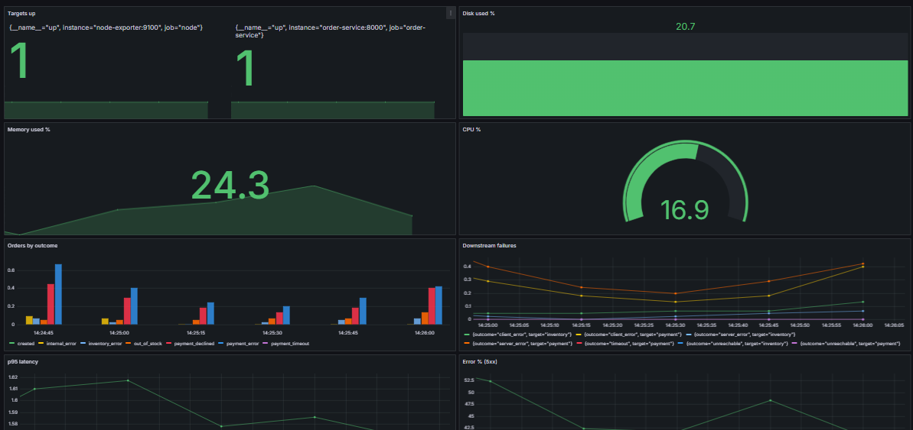<br>
  <sub><i>Figure 1. The Grafana dashboard under normal traffic.</i></sub>
</p>

---

## 1. Architecture and data flow

```
 Laptop browser --SSH tunnel (3000, 9090, 8080)--> EC2 instance (private, SSH only)
                                                    |
   Docker Compose                                   |   MicroK8s
   -------------------------------                  |   ------------------------------
   shop app --------> Prometheus <---- Node Exporter|   shop pods (namespace shop-demo)
                          |                         |         |  pod logs (Kubernetes API)
                          v                         |         v
                       Grafana <------ Loki <-------+---- Alloy  (push to 172.17.0.1:3100)
                          |
                          +--> alert email (SMTP 587)
```

The shop runs twice on purpose. The Compose copy feeds the metrics, and the MicroK8s copy feeds the logs, because Alloy collects logs from Kubernetes pods.

---

## 2. EC2 deployment

| Item                  | Value                                                                                                                                              |
|-----------------------|----------------------------------------------------------------------------------------------------------------------------------------------------|
| Region                | Asia Pacific (Sydney), ap-southeast-2                                                                                                              |
| Instance              | observability-lab, t3.large (8 GB RAM), 30 GB gp3                                                                                                  |
| OS                    | Ubuntu 26.04 LTS (see `evidence/environment.txt`)                                                                                                  |
| Security group        | One inbound rule: SSH (22) from my IP only. No other ports are open.                                                                               |
| Public IP             | Used for SSH only.                                                                                                                                 |
| Access to the web UIs | SSH tunnel (LocalForward 3000, 9090, 8080)                                                                                                         |
| Approval              | The instructor approved running the stack on a private EC2 instance, SSH only from my IP and no public ports. The reply was kept before launching. |

SSH config on the laptop (`~/.ssh/config`):

```
Host obs
    HostName <EC2-public-IP>
    User ubuntu
    IdentityFile ~/.ssh/obs-key.pem
    LocalForward 3000 127.0.0.1:3000
    LocalForward 9090 127.0.0.1:9090
    LocalForward 8080 127.0.0.1:8080
    ServerAliveInterval 30
    Compression yes
```

Run `ssh obs` and keep that window open. Then use:

| Page          | URL on the laptop      |
|---------------|------------------------|
| Grafana       | http://localhost:3000  |
| Prometheus    | http://localhost:9090  |
| Shop frontend | http://localhost:8080  |

---

## 3. Setup

### 3.1 Install Docker and MicroK8s (on EC2)

Docker Engine and the Compose plugin come from Docker's apt repository. MicroK8s is installed with snap and the add-ons `dns`, `hostpath-storage` and `helm3` are enabled. To let Docker and MicroK8s share one host:

```bash
sudo iptables -P FORWARD ACCEPT
sudo apt install -y iptables-persistent && sudo netfilter-persistent save
```

### 3.2 Start the Compose stack

```bash
cd ~/30251_observability
touch .env                        # SMTP settings go here (see section 6); never submitted
docker compose --profile loadgen up -d --build
docker compose ps                 # everything should be running / healthy
```

Services in `compose.yaml`:

| Service                                      | Image                      | Published port      | Notes                                                       |
|----------------------------------------------|----------------------------|---------------------|-------------------------------------------------------------|
| frontend, order, payment, inventory services | built from `app/`          | 127.0.0.1 only      | the demo shop                                               |
| prometheus                                   | `prom/prometheus:v2.55.1`  | 127.0.0.1:9090      | config in `prometheus/prometheus.yml`, volume prometheus-data |
| node-exporter                                | `prom/node-exporter:v1.8.2`| none                | mounts `/` as `/host:ro,rslave`, `--path.rootfs=/host`      |
| loki                                         | `grafana/loki:3.2.1`       | 172.17.0.1:3100     | config in `loki/loki-config.yaml`, volume loki-data         |
| grafana                                      | `grafana/grafana:11.3.0`   | 127.0.0.1:3000      | provisioned from files, volume grafana-data                 |

Every service uses `restart: unless-stopped`. Only Grafana and Prometheus are published for the UI, both on 127.0.0.1.

<p align="center">
  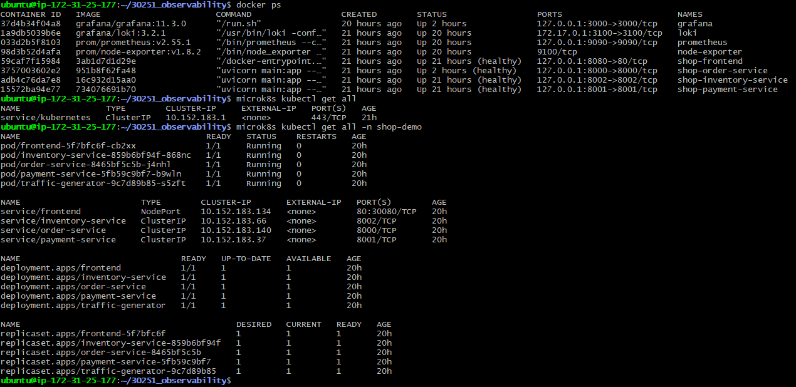<br>
  <sub><i>Figure 2. Containers started by Docker Compose, and the MicroK8s <code>shop-demo</code> namespace.</i></sub>
</p>

### 3.3 Prometheus

`prometheus/prometheus.yml` has a 15 s interval and two jobs: `node` (node-exporter:9100) and `order-service` (order-service:8000).

### 3.4 Grafana provisioning

- `grafana/provisioning/datasources/datasources.yaml` creates the Prometheus (uid `prometheus`, default) and Loki (uid `loki`) data sources.
- `grafana/provisioning/dashboards/dashboards.yaml` creates the Shop Observability folder and loads every JSON file in `grafana/dashboards/`.
- `grafana/dashboards/shop.json` is the exported dashboard.

### 3.5 Kubernetes workload and Alloy

```bash
chmod +x scripts/*.sh
./scripts/build-and-load-k8s.sh
microk8s kubectl -n shop-demo get pods

microk8s helm repo add grafana https://grafana.github.io/helm-charts
microk8s helm repo update
microk8s helm install alloy grafana/alloy -n monitoring --create-namespace \
  -f kubernetes/alloy-values.yaml
microk8s kubectl -n monitoring get pods
```

`kubernetes/alloy-values.yaml` uses `discovery.kubernetes` to find pods and `discovery.relabel` to keep the `shop-demo` namespace and set the labels `namespace`, `pod` and `container`. `loki.source.kubernetes` tails the logs, and `loki.write` pushes them to `http://172.17.0.1:3100/loki/api/v1/push`.

---

## 4. Loki networking method

Pods in MicroK8s cannot reach `localhost` of the host. Loki is therefore published on the Docker bridge address, `172.17.0.1:3100:3100` (docker0). Pods can reach that address, and nothing outside the host can, since the security group is closed.

- `sudo iptables -P FORWARD ACCEPT` (saved with `netfilter-persistent`) lets pod traffic reach the bridge.
- Check from a pod:

```bash
microk8s kubectl run curl --rm -it --restart=Never --image=curlimages/curl -- \
  curl -sS -m 5 -w "\nHTTP %{http_code}\n" http://172.17.0.1:3100/ready
```

Expected output: `ready` and `HTTP 200`.

---

## 5. Verification

| Check                             | How                                                                                         | Evidence                                                                                                                                                  |
|-----------------------------------|---------------------------------------------------------------------------------------------|-----------------------------------------------------------------------------------------------------------------------------------------------------------|
| Prometheus targets are UP         | http://localhost:9090/targets                                                               | `evidence/Screenshots/prometheus-targets.png`                                                                                                             |
| Node Exporter matches the host    | compare PromQL results with `free -m`, `df -h`, `uptime`                                    | `evidence/text/06-host-crosscheck.txt`, `evidence/text/06-promql-results.txt`                                                                             |
| Containers and cluster healthy    | `docker compose ps`, `microk8s kubectl get pods`                                            | `evidence/Screenshots/compose-and-cluster.png`, `evidence/text/02-compose-ps.txt`, `evidence/text/05-kubectl-shop-demo.txt`                               |
| Alloy running and healthy         | `microk8s kubectl -n monitoring get pods`                                                   | `evidence/Screenshots/alloy-and-pods.png`, `evidence/Screenshots/alloy-health.png`                                                                        |
| Loki ingestion                    | Loki API and Grafana Explore                                                                | `evidence/text/05-loki-ingestion.txt`, `evidence/text/05-loki-namespaces.txt`                                                                             |
| Live logs and an error filter     | `{namespace="shop-demo"}` and `{namespace="shop-demo"} \|~ "(?i)error"`                     | `evidence/Screenshots/kubernetes-logs.png`, `evidence/Screenshots/loki-explore-error.png`                                                                 |
| Data survives a restart           | `docker compose restart`, reload Grafana (named volumes)                                    | `evidence/Screenshots/grafana-metrics.png`                                                                                                                |

**Prometheus targets**

<p align="center">
  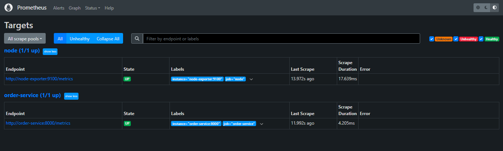<br>
  <sub><i>Figure 3. Both scrape jobs, <code>node</code> and <code>order-service</code>, are UP.</i></sub>
</p>

**Alloy and cluster pods**

<table>
  <tr>
    <td align="center">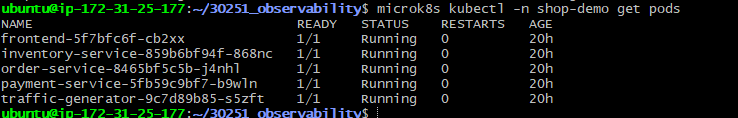<br><sub><i>Figure 4a. All namespaces: the <code>alloy</code> pod in <code>monitoring</code> is Running (2/2).</i></sub></td>
    <td align="center">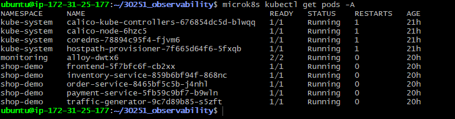<br><sub><i>Figure 4b. The five <code>shop-demo</code> pods are Running.</i></sub></td>
  </tr>
</table>

**Live logs and an error filter**

<p align="center">
  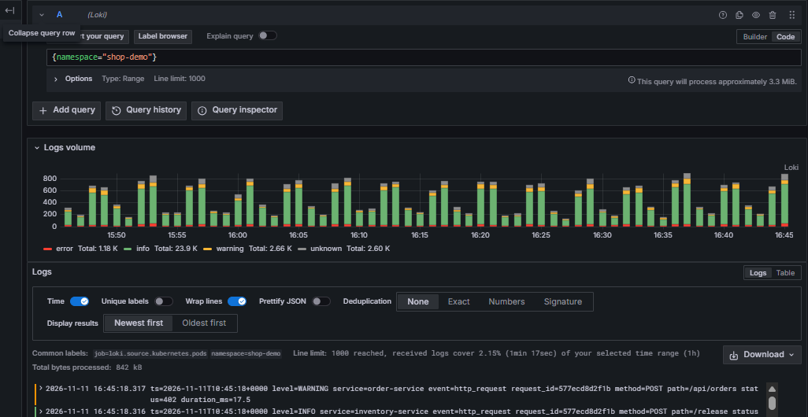<br>
  <sub><i>Figure 5. Grafana Explore with the Loki query <code>{namespace="shop-demo"}</code>: log volume by level and the log lines.</i></sub>
</p>

<p align="center">
  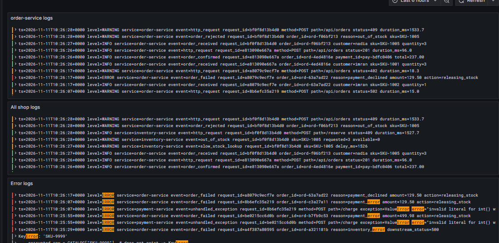<br>
  <sub><i>Figure 6. Dashboard log panels: order-service logs, all shop logs, and an error filter that highlights <code>ERROR</code> lines.</i></sub>
</p>

**Data survives a restart**

<p align="center">
  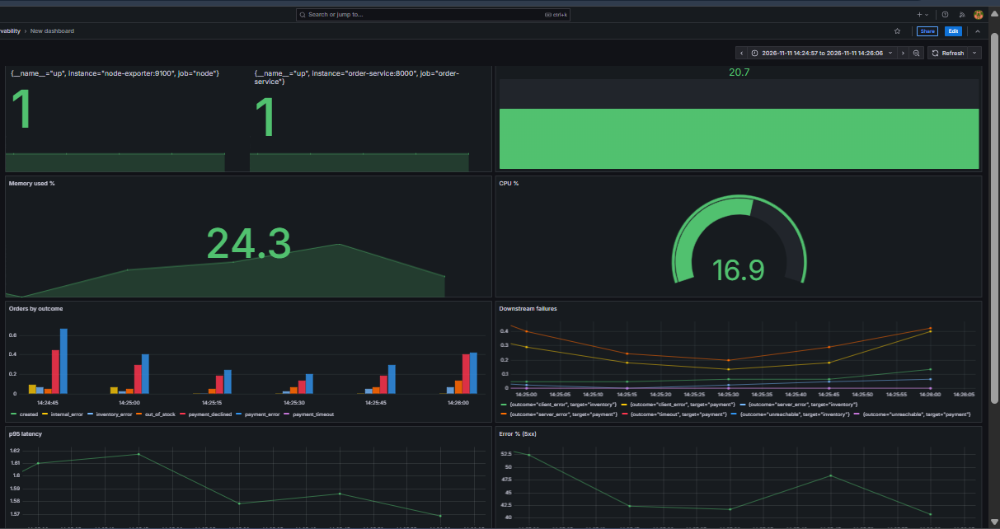<br>
  <sub><i>Figure 7. The dashboard still shows earlier data after the restart (named volumes).</i></sub>
</p>

### Dashboard (9 panels)

| Panel            | Type        | PromQL                                                                                                                                  |
|------------------|-------------|-----------------------------------------------------------------------------------------------------------------------------------------|
| Request rate     | Time series | `sum(rate(http_requests_total[1m]))`                                                                                                    |
| Error % (5xx)    | Time series | `100 * sum(rate(http_requests_total{status=~"5.."}[1m])) / sum(rate(http_requests_total[1m]))`                                          |
| p95 latency      | Time series | `histogram_quantile(0.95, sum by (le) (rate(http_request_duration_seconds_bucket[5m])))`                                                |
| Orders by outcome| Bar chart   | `sum by (outcome) (rate(shop_orders_total[1m]))`                                                                                        |
| Downstream failures | Time series | `sum by (target, outcome) (rate(downstream_requests_total{outcome!="ok"}[1m]))`                                                      |
| CPU %            | Gauge       | `100 - avg(rate(node_cpu_seconds_total{mode="idle"}[1m])) * 100`                                                                        |
| Memory used %    | Stat        | `100 * (1 - node_memory_MemAvailable_bytes / node_memory_MemTotal_bytes)`                                                               |
| Disk used %      | Bar gauge   | `100 - 100 * node_filesystem_avail_bytes{mountpoint="/"} / node_filesystem_size_bytes{mountpoint="/"}`                                  |
| Targets up       | Stat        | `up`                                                                                                                                    |

### Five PromQL expressions explained

1. `sum(rate(http_requests_total[1m]))`: `rate()` turns the ever-growing request counter into requests per second over the last minute, and `sum` adds all label combinations into one line.
2. The error percentage divides the rate of responses with a 5xx status by the rate of all responses, then multiplies by 100.
3. `histogram_quantile(0.95, ...)` estimates the latency under which 95 % of requests complete, using the histogram buckets (`le`) summed across series.
4. `sum by (outcome) (rate(shop_orders_total[1m]))` shows orders per second split by result (created, out_of_stock, payment_declined and so on).
5. `100 - avg(rate(node_cpu_seconds_total{mode="idle"}[1m])) * 100` is CPU use: the idle fraction averaged over all cores, subtracted from 100 %.

---

## 6. Email alert

SMTP settings are in an EC2-only `.env` file (`GF_SMTP_ENABLED`, `GF_SMTP_HOST` with port 587, user, app password, from address). The file is excluded from the submission, and `.env.example` shows only the demo defaults.

| Setting             | Value                                                                                           |
|---------------------|-------------------------------------------------------------------------------------------------|
| Contact point       | `email-admin` (Email)                                                                           |
| Notification policy | default policy sends to `email-admin`, group by `grafana_folder` and `alertname`, group wait 10 s |
| Rule                | `order-service down` in folder Shop Alerts                                                      |
| Query               | `up{job="order-service"}`, reduced with Last, threshold below 1                                 |
| Evaluation          | every 30 s, pending period 1 minute, no data = Alerting                                         |

Test:

```bash
docker compose stop order-service      # rule goes Normal -> Pending -> Firing, email arrives
docker compose start order-service     # a Resolved email follows
```

<p align="center">
  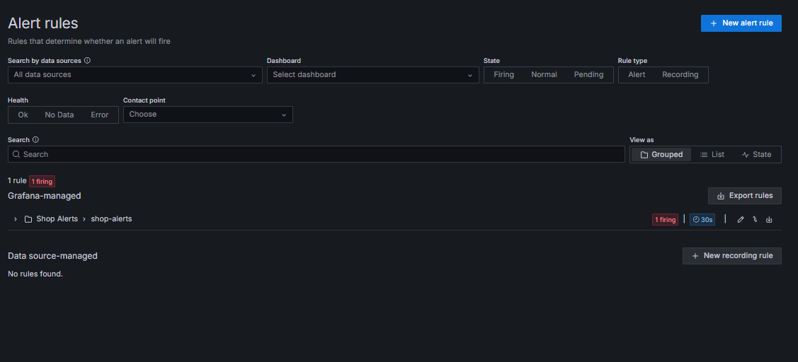<br>
  <sub><i>Figure 8. The <code>shop-alerts</code> rule group shows 1 firing while order-service is stopped.</i></sub>
</p>

<p align="center">
  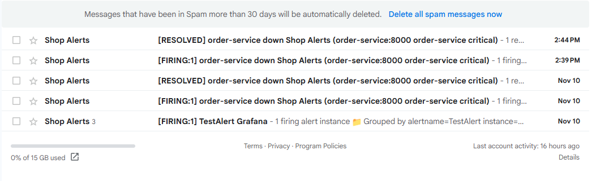<br>
  <sub><i>Figure 9. The <code>[FIRING]</code> and <code>[RESOLVED]</code> emails for <code>order-service down</code>.</i></sub>
</p>

Evidence: `evidence/Screenshots/alert-firing.png`, `evidence/Screenshots/email-alert.png`. Threshold, duration, recipient and operator actions are in [`alerting/configuration-notes.md`](alerting/configuration-notes.md).

---

## 7. Demo steps

```bash
docker compose stop traffic-generator          # keep the graphs clean
./scripts/traffic-test.sh normal               # steady low traffic
./scripts/traffic-test.sh burst                # sudden spike
./scripts/traffic-test.sh chaos-on             # inject payment failures
./scripts/traffic-test.sh normal               # send traffic while chaos is on
./scripts/traffic-test.sh chaos-off
docker compose start traffic-generator
```

| Scenario | What changes on the dashboard                              | Evidence                                                                 |
|----------|------------------------------------------------------------|--------------------------------------------------------------------------|
| normal   | low, steady request rate, few errors                       | `evidence/Screenshots/dashboard-normal.png`, `evidence/text/04a-normal-*.txt` |
| burst    | request rate and latency rise, in-flight requests increase | `evidence/Screenshots/dashboard-burst.png`, `evidence/text/04b-burst-*.txt`   |
| chaos-on | error % and failed order outcomes rise                     | `evidence/Screenshots/dashboard-chaos.png`, `evidence/text/04c-chaos-*.txt`   |

<p align="center">
  <br>
  <sub><i>Figure 10. Scenario <b>normal</b>: low, steady request rate.</i></sub>
</p>

<p align="center">
  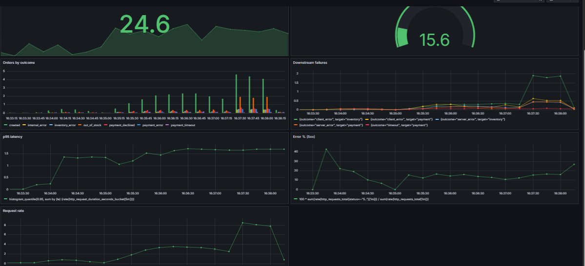<br>
  <sub><i>Figure 11. Scenario <b>burst</b>: request rate and latency rise.</i></sub>
</p>

<p align="center">
  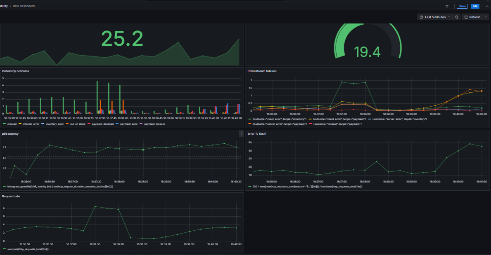<br>
  <sub><i>Figure 12. Scenario <b>chaos-on</b>: downstream failures and the 5xx error % rise.</i></sub>
</p>

The traffic scripts send requests to the Compose order-service (port 8000), so they change the metrics. The logs in Loki come from the pods in MicroK8s.

---

## 8. Project layout

```
.
|-- README.md
|-- compose.yaml
|-- .env.example
|-- alerting/configuration-notes.md
|-- app/                       shop services, frontend, traffic generator
|-- docs/app-reference.md      original demo application documentation
|-- evidence/                  screenshots/ and text/ command outputs, environment.txt
|-- grafana/
|   |-- dashboards/shop.json
|   `-- provisioning/{datasources,dashboards}/
|-- kubernetes/                namespace.yaml, workload.yaml, alloy-values.yaml
|-- loki/loki-config.yaml
|-- prometheus/prometheus.yml
`-- scripts/                   traffic-test.sh, build-and-load-k8s.sh
```

---

## 9. Cleanup

After the evaluation:

```bash
docker compose --profile loadgen down -v
microk8s helm uninstall alloy -n monitoring
microk8s kubectl delete ns shop-demo monitoring
```

Then in the AWS Console: terminate the instance (stopping is not enough, the disk is still billed).
