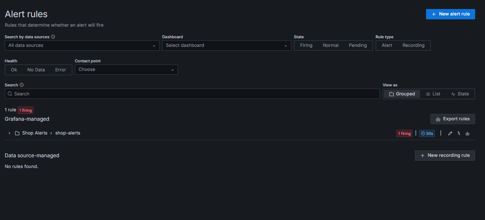
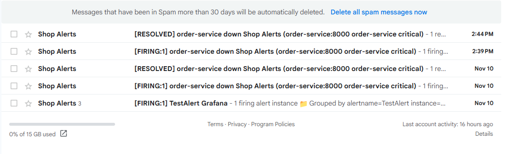
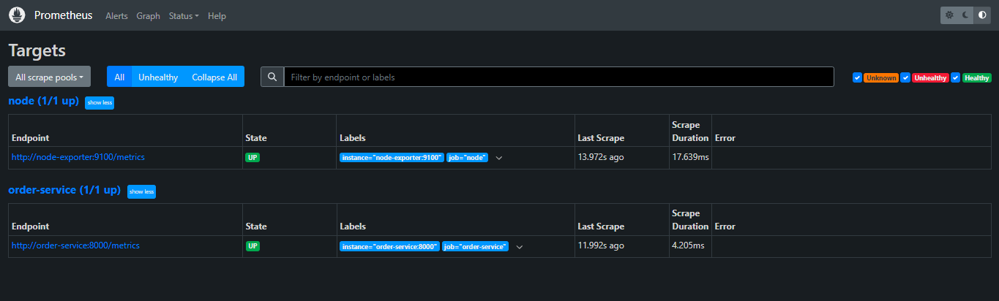

# Alert configuration notes

- **Alert:** order-service down
- **Condition:** `up{job="order-service"}` is below 1 (Prometheus cannot scrape the service)
- **Threshold:** < 1
- **Duration:** must hold for 1 minute (pending period); evaluated every 30 s
- **No data handling:** treated as Alerting
- **Recipient:** rashedul16801@gmail.com
- **Delivery:** Grafana email contact point `email-admin` via SMTP on port 587
  (credentials kept in an EC2-only .env, not included in the submission)
- **Operator action:**
  1. Run `docker compose ps` and check whether order-service is stopped or unhealthy.
  2. Check `docker compose logs order-service --tail=50` (or Loki in Grafana Explore).
  3. Restart with `docker compose start order-service`.
  4. Confirm the target is UP at http://localhost:9090/targets and wait for the resolved email.

## Evidence

### 1. The alert rule is firing

With `order-service` stopped, the `shop-alerts` rule group in Grafana shows **1 firing**.

  

### 2. Notification emails

Grafana sends a `[FIRING]` email when the alert starts and a `[RESOLVED]` email when the service is back.

  

### 3. Target back UP

After `docker compose start order-service`, Prometheus shows the target as **UP** again, which clears the alert.

  

